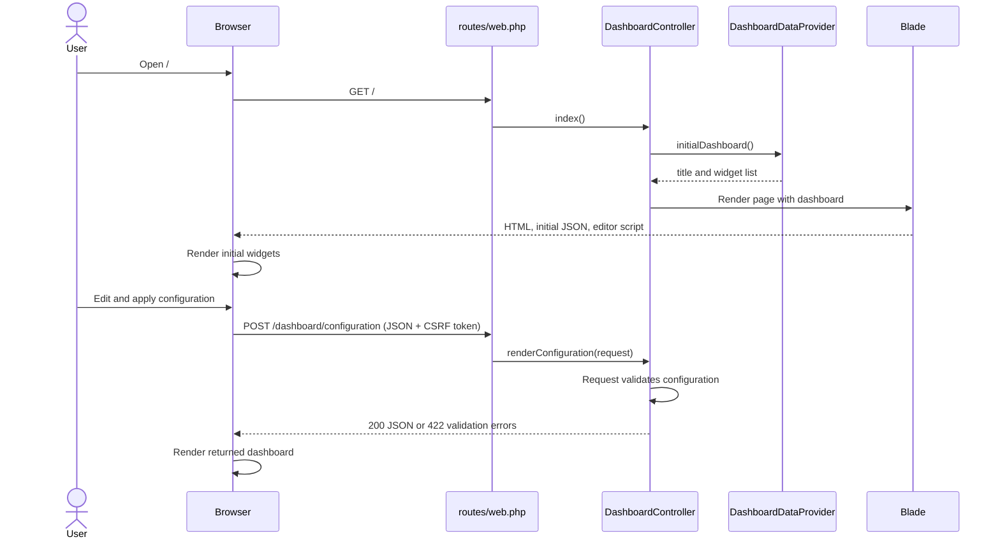

# Architecture and data flow

## Component responsibilities

- `routes/web.php` defines the dashboard page and two JSON endpoints.
- `DashboardController::index()` gets the initial dashboard from `DashboardDataProvider` and passes it to Blade.
- `RenderDashboardConfigurationRequest` validates submitted dashboard JSON, including widget limits, unique IDs/positions, visualization settings, and record requirements.
- `DashboardController::renderConfiguration()` returns the validated dashboard as JSON. It does not store it.
- `DashboardController::data()` asks `DashboardDataProvider` for a fixed sample by identifier and returns its configuration and records. Unknown IDs return 404.
- `resources/views/dashboard/index.blade.php` supplies the page shell and initial data to the reusable Blade component.
- `resources/views/components/universal-dashboard.blade.php` outputs the dashboard/editor DOM and embeds the initial dashboard JSON as a data attribute.
- `public/js/dashboard.js` builds the editor, posts JSON, and renders each accepted widget. Chart.js draws pie/bar/line charts; native DOM APIs build tables.
- `resources/views/layouts/app.blade.php` supplies page styles and the Chart.js CDN include. The current layout does not load the dashboard through Vite.

There is no database access in this request flow. The browser's edited dashboard exists in page memory and in the POST request/response only.

## Initial page and configuration submission



## Configuration contract

The POST body has one top-level `dashboard` object. A dashboard has a title and 1–24 widgets. Each widget has a unique ID, title, list of record objects, visualization, and unique grid position.

```json
{
  "dashboard": {
    "title": "Team Overview",
    "widgets": [
      {
        "id": "weekly-revenue",
        "title": "Weekly Revenue",
        "data": [{ "week": "Week 1", "amount": 120 }],
        "visualization": {
          "type": "line",
          "labelKey": "week",
          "valueKey": "amount"
        },
        "position": { "column": 1, "row": 1 }
      }
    ]
  }
}
```

Chart types are `pie`, `bar`, and `line`; each requires a label and numeric value field. Pie values must be nonnegative. Table type is `table`; columns can be supplied as `{key,label}` entries or inferred from the first record. Grid columns are 1–2 and rows 1–12. See [developer guide](DEVELOPER_GUIDE.md) for exact rules.

## Sample data endpoint

`GET /dashboard/data/{dataset}` resolves only the hardcoded `sales`, `support`, and `inventory` identifiers in `DashboardDataProvider`. Its success envelope is `{ "dataset": "...", "configuration": {...}, "data": [...] }`. This endpoint serves examples independently from the editable dashboard configuration; it does not accept caller-defined dataset IDs or fetch external data.

## Rendering and layout

The script dispatches by `widget.visualization.type`. It uses configured label/value keys for charts and configured or inferred columns for tables. Widget `position.column` and `position.row` become CSS Grid placement values. Chart instances are tracked and destroyed before a dashboard rerender. The grid has two columns on wide layouts and collapses to one on narrower screens.

The editor sends `Accept: application/json`, `Content-Type: application/json`, and `X-CSRF-TOKEN` (from the page meta tag), using same-origin credentials. The PowerShell API example in the README uses the Laravel web route from outside the browser; depending on session/CSRF middleware configuration, a browser-based caller should use the session token provided by the page.

## Verification boundary

Feature tests cover HTTP responses and validation. They do not run JavaScript in a browser, prove chart appearance, test interactive editor flows, or measure responsive rendering. Chart.js is loaded from jsDelivr, so chart display depends on browser network access.
